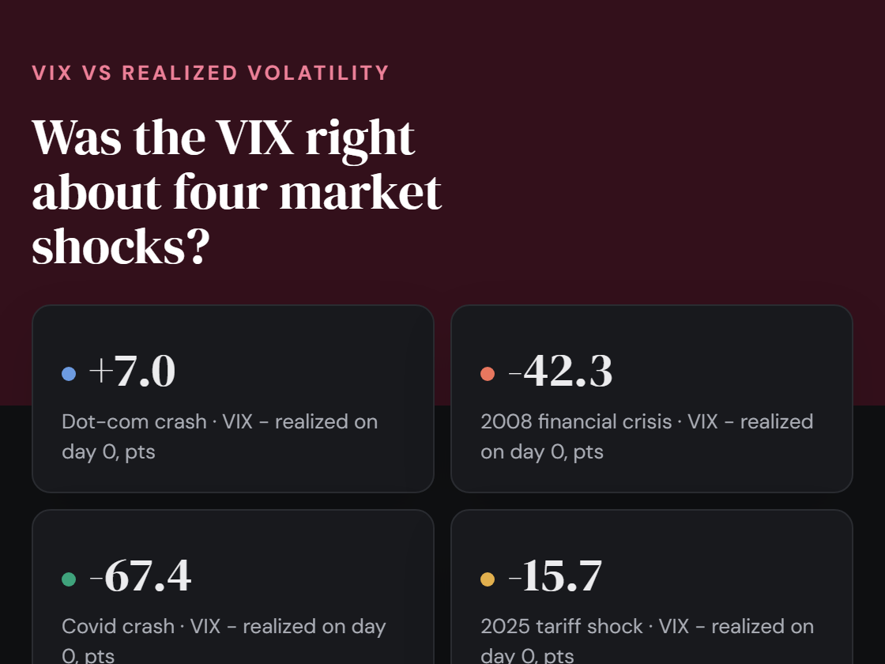
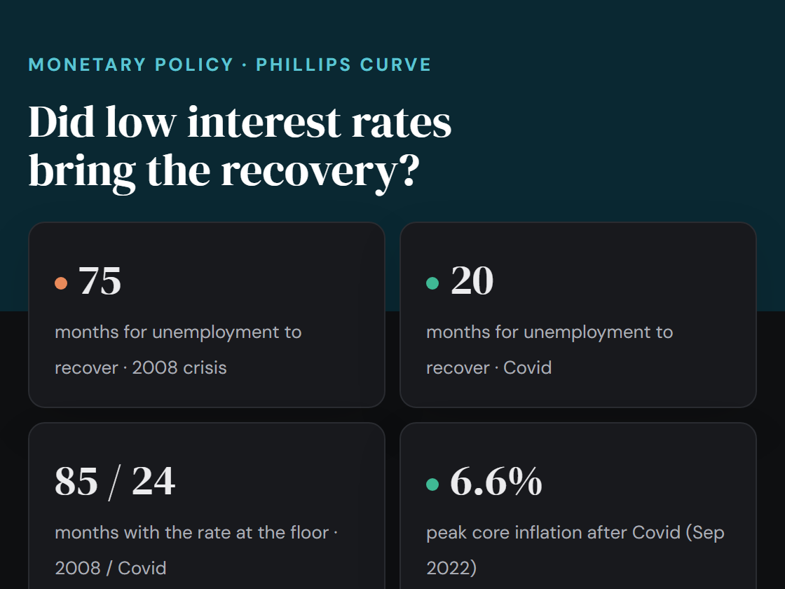
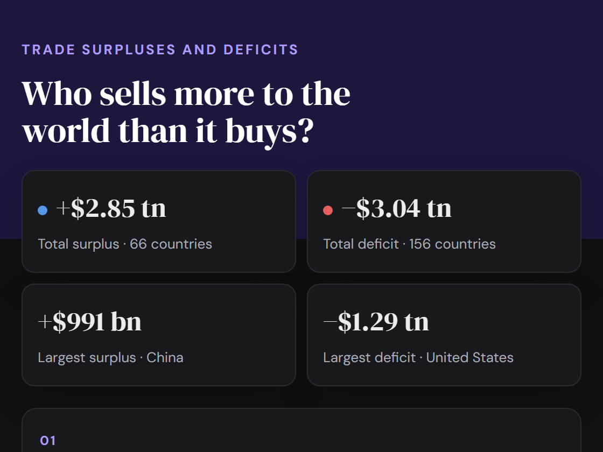
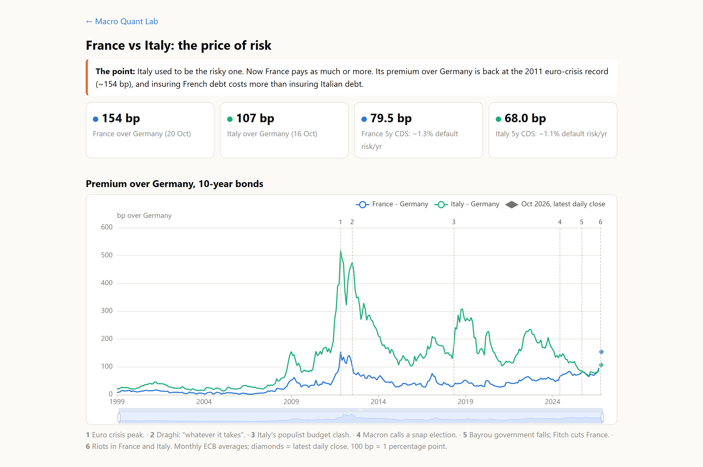
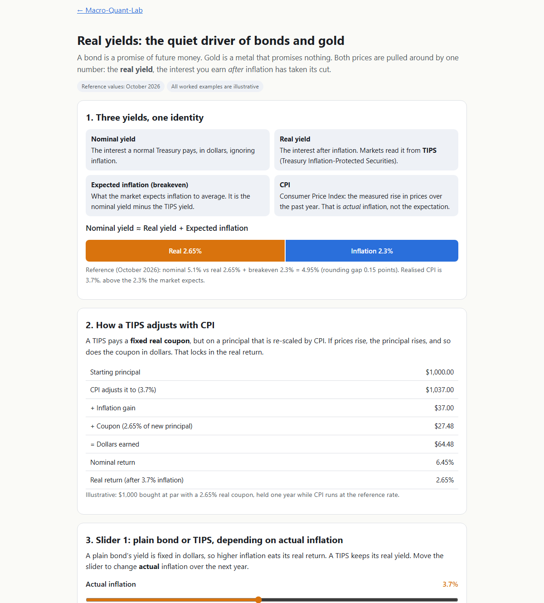
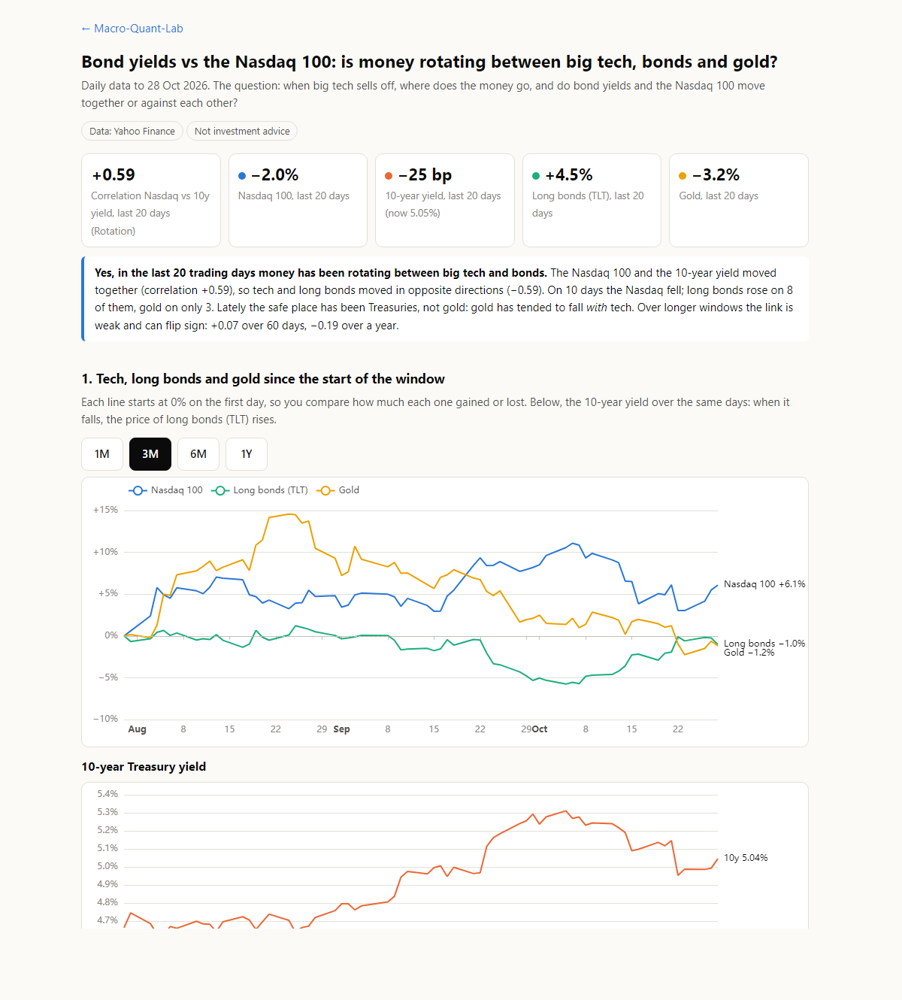

# Macro Quant Lab

A personal lab for testing ideas at the intersection of macroeconomics,
machine learning, and quantitative trading — a space to try things, break
things, and see what actually holds up.

🌐 **Website: [manucem.github.io/Macro-Quant-Lab](https://manucem.github.io/Macro-Quant-Lab/)** — an index of the live experiments.

## Featured: was the VIX right about four market shocks?

**[▶ Open live dashboard](https://manucem.github.io/Macro-Quant-Lab/VIX/output/shocks.html)**

[](https://manucem.github.io/Macro-Quant-Lab/VIX/output/shocks.html)

The VIX is the market's ~30-day volatility forecast, built from S&P 500 option
prices. Each day's VIX is compared with the volatility that actually followed
over the next 21 trading days, around the dot-com crash, 2008, Covid and the
2025 tariff shock.

**Takeaway:** the VIX tracks volatility well (correlation ~0.7) and is above
realized volatility on ~84% of days (+3.8 pts on average — the price of
insurance). But it reacts to shocks rather than predicting them: it
underestimated the first weeks of 2008 and Covid, and overshot afterwards.

| Episode | Avg VIX | Avg realized | VIX − realized | Market | S&P, day 0 to low |
|---|---|---|---|---|---|
| Dot-com (2000–02) | 25.4 | 22.1 | +3.3 | Slightly overreacted | −42.7% |
| 2008 crisis | 48.8 | 53.0 | −4.2 | Underestimated | −43.3% |
| Covid 2020 | 41.4 | 48.0 | −6.6 | Underestimated | −30.6% |
| Tariff shock (Apr–mid-May 2025) | 28.4 | 21.8 | +6.6 | Overreacted | −7.7% |

Run it yourself:

```bash
pip install yfinance pandas numpy plotly
python VIX/volatility.py   # 30 years of VIX vs realized volatility + bias/RMSE
python VIX/shocks.py       # the four-shock dashboard (VIX/output/shocks.html)
```

## Featured: did near-zero interest rates bring a recovery?

**[▶ Open live dashboard](https://manucem.github.io/Macro-Quant-Lab/Rates_and_Phillips/rates_phillips.html)**

[](https://manucem.github.io/Macro-Quant-Lab/Rates_and_Phillips/rates_phillips.html)

The Phillips curve says unemployment and inflation trade off; the Fed's tool for
moving along it is the interest rate. Using monthly US data from FRED (unemployment,
core CPI inflation, Fed funds rate), this compares how the economy recovered after
the 2008 crisis and Covid, with the Phillips curve coloured by the Fed funds rate and
the real rate (Fed funds minus inflation).

**Takeaway:** cheap money was slow in 2008 and overshot in 2020-22.

| Crisis | Peak unemployment | Months to recover* | Months at floor** | Peak core inflation | Lowest real rate |
|---|---|---|---|---|---|
| 2008 crisis | 10.0% | 75 | 85 | 2.9% | −2.2% |
| Covid | 14.8% | 20 | 24 | 6.6% | −6.4% |

\* within 0.5 points of the pre-crisis low, counted from the unemployment peak.
\*\* Fed funds rate at 0.25% or less.

Run it yourself:

```bash
pip install pandas statsmodels
python Rates_and_Phillips/rates_phillips.py   # downloads from FRED (no API key) and writes rates_phillips.html
```

## Featured: who sells more to the world than it buys?

**[▶ Open live map](https://manucem.github.io/Macro-Quant-Lab/Deficit_Surplus/trade_balance.html)**

[](https://manucem.github.io/Macro-Quant-Lab/Deficit_Surplus/trade_balance.html)

A country's trade balance is exports minus imports: a surplus means it sells more
than it buys, a deficit the opposite. Using 2024 goods trade from UN Comtrade (no API
key) for 222 countries, the map colours every country by its balance. Picking a
country switches the colours off and highlights only its top 3 buyers (exports) or
sellers (imports), with numbered arrows; the full top 10 is in a table. The 75
countries that did not report (Russia, Vietnam, UAE...) are estimated from what their
partners reported (mirror statistics).

**Takeaway:** the US deficit alone (−$1.29 tn) is bigger than China's surplus
(+$991 bn). And the world does not add up to zero (−$194 bn), because imports include
freight and insurance, shipments cross the year end, and hubs re-export.

| Biggest surpluses | Balance | Biggest deficits | Balance |
|---|---|---|---|
| China | +$991 bn | United States | −$1,293 bn |
| Germany | +$254 bn | United Kingdom | −$293 bn |
| Russia* | +$197 bn | India | −$263 bn |
| Vietnam* | +$132 bn | France | −$116 bn |
| Ireland | +$98 bn | Turkey | −$82 bn |

\* estimated from partners' data (the country did not report its own 2024 figures).

Run it yourself:

```bash
pip install pandas requests
python Deficit_Surplus/trade_balance.py   # downloads from UN Comtrade (first run ~10 min) and writes trade_balance.html
```

## Featured: is France now riskier than Italy?

**[▶ Open live dashboard](https://manucem.github.io/Macro-Quant-Lab/Yield_Curve/sovereign_spreads.html)**

[](https://manucem.github.io/Macro-Quant-Lab/Yield_Curve/sovereign_spreads.html)

Germany is the euro area's "safe" borrower, so the gap between a country's 10-year
yield and Germany's (the spread, in basis points; 100 bp = 1 percentage point) measures
how risky the market thinks it is. Using monthly 10-year yields from the ECB data portal
(no API key) since 1999, this tracks France and Italy against Germany, adds the latest
daily spreads and 5-year credit default swaps (CDS, insurance on a government's debt)
from the press, and turns each CDS premium into the yearly default probability it implies
(premium / (1 − 40% recovery)).

**Takeaway:** Italy used to be the risky one. France's spread is back at the 2011
euro-crisis record (~154 bp on 20 Oct 2026), France paid more than Italy in 5 of the
last 12 months, and insuring French debt costs more than insuring Italian debt.

| Country | Spread over Germany | Record since 1999 | 5y CDS | Implied default risk / year |
|---|---|---|---|---|
| France | ~154 bp (20 Oct)* | 154 bp (Nov 2011) | 79.5 bp | ~1.3% |
| Italy | ~107 bp (16 Oct)* | 519 bp (Nov 2011) | 68.0 bp | ~1.1% |
| Germany | — | — | 7.3 bp | ~0.1% |

\* latest daily close reported in the press; the ECB monthly average for Sep 2026 is
97 bp (France) and 89 bp (Italy). The CDS quotes come from different days (no free CDS feed).

Run it yourself:

```bash
pip install pandas
python Yield_Curve/sovereign_spreads.py   # downloads from the ECB (no API key) and writes sovereign_spreads.html
```

## Featured: why do bonds and gold move with real yields?

**[▶ Open live page](https://manucem.github.io/Macro-Quant-Lab/tips-gold-bonds/tips_gold_bonds.html)**

[](https://manucem.github.io/Macro-Quant-Lab/tips-gold-bonds/tips_gold_bonds.html)

A learning page, explained step by step with two sliders. A nominal Treasury yield
splits into a real yield (what a TIPS pays, since its principal grows with CPI) plus
expected inflation (the breakeven). Gold pays no coupon, so the real yield is what you
give up by holding it. Nothing is downloaded: the October 2026 reference values are
typed in by hand and only illustrative.

**Takeaway:** nominal 5.1% = real 2.65% + breakeven 2.3% (a 0.15-point rounding gap).
A plain bond beats a TIPS only if actual inflation stays below ~2.4%; a $1,000 TIPS at
3.7% CPI earns $64.48 (+6.45%), which is still a 2.65% real return.

| Reference value (Oct 2026) | Level |
|---|---|
| 10-year nominal yield | 5.1% |
| 10-year TIPS (real) yield | 2.65% |
| 10-year breakeven (expected inflation) | 2.3% |
| US CPI inflation | 3.7% |

Run it yourself:

```bash
python tips-gold-bonds/tips_gold_bonds.py   # standard library only; writes tips_gold_bonds.html
```

## Featured: is money rotating between big tech, bonds and gold?

**[▶ Open live dashboard](https://manucem.github.io/Macro-Quant-Lab/nasdaq-bonds/nasdaq_bonds.html)**

[](https://manucem.github.io/Macro-Quant-Lab/nasdaq-bonds/nasdaq_bonds.html)

Two stories pull in opposite directions. **Rate fear:** higher yields shrink the value of
tech's far-away profits, so yields up = Nasdaq down (negative correlation). **Rotation:**
investors sell tech and buy Treasuries, pushing bond prices up and yields down, so the
Nasdaq and yields move *together* (positive correlation). Using daily Yahoo Finance data
(Nasdaq 100, 10-year yield, the TLT long-bond ETF, gold), this measures the correlation of
daily moves over rolling 20- and 60-day windows for 5 years, and checks where the money went
on the Nasdaq's down days.

**Takeaway (data to 28 Oct 2026):** the last 20 trading days are a rotation: correlation
+0.59; the Nasdaq fell 2.0%, the 10-year yield 25 bp, and long bonds gained 4.5%. On 8 of the
10 Nasdaq down days bonds rose, gold only on 3: the haven has been Treasuries, not gold. The
link is recent and unstable: +0.07 over 60 days, −0.19 over a year, −0.67 in June 2026.

| Window | Corr. Nasdaq vs 10y yield | Nasdaq | 10y yield | Long bonds (TLT) | Gold | Regime |
|---|---|---|---|---|---|---|
| Last 20 days | +0.59 | −2.0% | −25 bp | +4.5% | −3.2% | Rotation |
| Last 60 days | +0.07 | +0.3% | +42 bp | −1.4% | −2.4% | No clear link |
| Last year | −0.19 | +14.1% | +99 bp | −7.0% | +1.3% | No clear link |

Run it yourself:

```bash
pip install yfinance pandas numpy
python nasdaq-bonds/nasdaq_bonds.py   # downloads from Yahoo Finance and writes nasdaq_bonds.html
```

## What's here

Each folder is a self-contained experiment:

- **VIX/** — the VIX vs realized volatility study above.
  [▶ Open live dashboard](https://manucem.github.io/Macro-Quant-Lab/VIX/output/shocks.html)
- **Rates_and_Phillips/** — policy rates of the European Central Bank (key rates) and
  the US Federal Reserve (EFFR and SOFR), plus the interest rates and
  Phillips curve study above (2008 and Covid).
  [▶ Open live dashboard](https://manucem.github.io/Macro-Quant-Lab/Rates_and_Phillips/index.html)
- **Deficit_Surplus/** — world map of trade surpluses and deficits in goods (UN
  Comtrade), the trade map above. Surplus/Deficit filter, the total in the corner;
  pick a country to highlight only its top 3 buyers or sellers with numbered arrows
  (top 10 in a corner table). Click a country again to switch between its exports and imports, and a third time to go back to the world map. Run
  `python Deficit_Surplus/trade_balance.py` (no API key; first run ~10 min).
  [▶ Open live map](https://manucem.github.io/Macro-Quant-Lab/Deficit_Surplus/trade_balance.html)
- **Yield_Curve/** — France and Italy 10-year yields vs Germany (ECB data since 1999),
  who pays more to borrow, and 5-year CDS turned into an implied default probability,
  the spread study above. Run `python Yield_Curve/sovereign_spreads.py` (no API key).
  [▶ Open live dashboard](https://manucem.github.io/Macro-Quant-Lab/Yield_Curve/sovereign_spreads.html)
- **tips-gold-bonds/** — real yields explained: nominal = real + breakeven, how a TIPS
  adjusts with CPI, plain bond vs TIPS by actual inflation, and why gold competes with
  the real yield (two sliders). Run `python tips-gold-bonds/tips_gold_bonds.py` (standard
  library only).
  [▶ Open live page](https://manucem.github.io/Macro-Quant-Lab/tips-gold-bonds/tips_gold_bonds.html)
- **nasdaq-bonds/** — Nasdaq 100 vs the 10-year yield, long bonds (TLT) and gold: rolling
  20- and 60-day correlations over 5 years ("rate fear" vs "rotation"), a day-by-day scatter
  and where the money went on tech's bad days. Run `python nasdaq-bonds/nasdaq_bonds.py`
  (Yahoo Finance, no API key).
  [▶ Open live dashboard](https://manucem.github.io/Macro-Quant-Lab/nasdaq-bonds/nasdaq_bonds.html)
- **bond-30y/** — pulls 30-year Treasury yield data, engineers technical
  features, and predicts next-day direction (up/down), validated with
  time-series cross-validation.
- **sp500/** — same approach applied to the S&P 500 index, with added
  volume and Bollinger Band features.

More will be added as new ideas come up — this is a lab, not a finished product.

## How it runs

It's wired to an n8n + Telegram automation: a Telegram command triggers an n8n
workflow, which runs the script on a server, sends the raw output to an LLM for
interpretation, and replies back in Telegram. A sample of the n8n workflow
(credentials and IDs scrubbed) is included in this repo for reference.

For security, the workflow **never pulls code automatically**: updating the
server's copy of this repo is a manual step, done only after reviewing the
changes. An automatic `git pull` would mean a compromised repo = code
execution on the server. The bot also only answers one authorized Telegram
user, in private chat, with a cooldown between commands.

## License

MIT — see [LICENSE](LICENSE).
